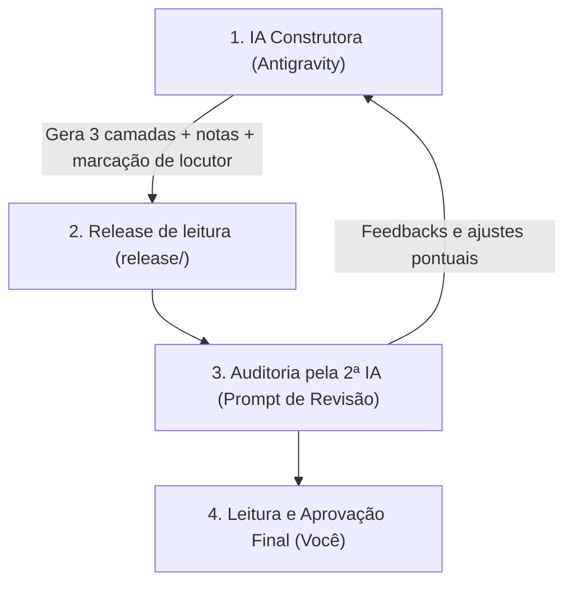

# Roadmap — Tradução Koiné Contemporânea (TKC)

Este documento detalha o planejamento das fases de tradução, o fluxo de trabalho colaborativo (IA Construtora + IA Revisora + Aprovação Humana) e a arquitetura dos dados para o futuro aplicativo móvel.

---

## 🗺️ Fases do Projeto

### Novo Testamento (Grego Koiné)

1. **Fase 1 — O Evangelho segundo João (Cap. 1 ao 21)**
   - *Status:* Cap. 1 concluído (vv. 1-51), revisado sob as regras R1-R11 e com marcação de locutor aplicada.
   - *Próxima etapa:* João 2 (as bodas de Caná e a purificação do Templo).
   - *Destaques:* O Livro dos Sinais (Cap. 2-12) e o Livro da Glória (Cap. 13-21).

2. **Fase 2 — As Grandes Epístolas Teológicas de Paulo**
   - *Livros:* Romanos, Gálatas, Efésios, Filipenses, Colossenses.
   - *Destaques:* Sintaxe paulina densa, teologia da justificação, mistério de Cristo e a Igreja.

3. **Fase 3 — Os Evangelhos Sinóticos e Atos dos Apóstolos**
   - *Livros:* Marcos (o mais antigo), Mateus, Lucas e Atos dos Apóstolos.
   - *Destaques:* Comparativo sinótico, parábolas, narrativa histórica da expansão missionária.

4. **Fase 4 — As Epístolas Pastorais, Coríntios e Cartas Menores**
   - *Livros:* 1 e 2 Coríntios, 1 e 2 Tessalonicenses, 1 e 2 Timóteo, Tito, Filemom.

5. **Fase 5 — Epístolas Gerais e Carta aos Hebreus**
   - *Livros:* Hebreus, Tiago, 1 e 2 Pedro, 1, 2 e 3 João, Judas.
   - *Destaques:* Grego literário de Hebreus, sabedoria prática e exortações escatológicas.

6. **Fase 6 — O Apocalipse de João**
   - *Livros:* Apocalipse (22 capítulos).
   - *Destaques:* Simbolismo do Antigo Testamento, literatura apocalíptica judaica do Segundo Templo.

---

## 🔄 Fluxo de Trabalho em 4 Etapas (Pipeline Multi-IA)



### Prompt Modelo para Você Enviar à 2ª IA de Revisão:
```text
Atue como um Professor Doutor em Grego Neotestamentário e Crítica Textual.
Revise a seguinte tradução autoral e suas notas exegéticas correspondentes.

Avalie rigorosamente:
1. Precisão e fidelidade ao texto grego crítico (SBLGNT / NA28).
2. Nuances sintáticas (aspectos verbais aoristo/imperfeito, casos gramaticais, artigos).
3. Naturalidade, fluência e dignidade literária em Língua Portuguesa moderna.
4. Clareza e profundidade teológico-histórica das notas exegéticas.

[COLE AQUI O CONTEÚDO DO CAPÍTULO EM MARKDOWN]
```

---

## 📱 Escopo dos Dados para o Futuro Aplicativo Mobile

O aplicativo será construído apenas após a conclusão e validação dos textos, consumindo os seguintes artefatos já gerados pelo pipeline:

1. **SQLite (`biblia.db`):**
   - Funciona 100% offline.
   - Tabelas normalizadas: `translation_meta`, `books`, `chapters`, `verses`, `verse_notes`, `verse_speech_spans`.
   - Índices para pesquisa textual instantânea em milissegundos.

2. **JSON Modular (`content/json/`):**
   - Ideal para carregar dinamicamente capítulos sob demanda.
   - Suporte para UI com **Modo Leitura Fluida** (texto limpo) e **Modo Exegese** (toque no versículo para abrir interlinear e notas).

3. **Release HTML (`release/`):**
   - Leitura humana apenas — **não é insumo do app**, que consome JSON e SQLite.
   - Único formato que preserva a marcação de locutor (o Markdown do GitHub descarta estilo inline).
   - Índice de livros, menu de capítulos e notas ancoradas nos números de versículo.

4. **Metadados da versão (`translation_meta`):**
   - Nome, sigla, idioma, texto-base e licença.
   - A CC BY-SA 4.0 exige atribuição e indicação da licença: o app deve exibir ambos.
